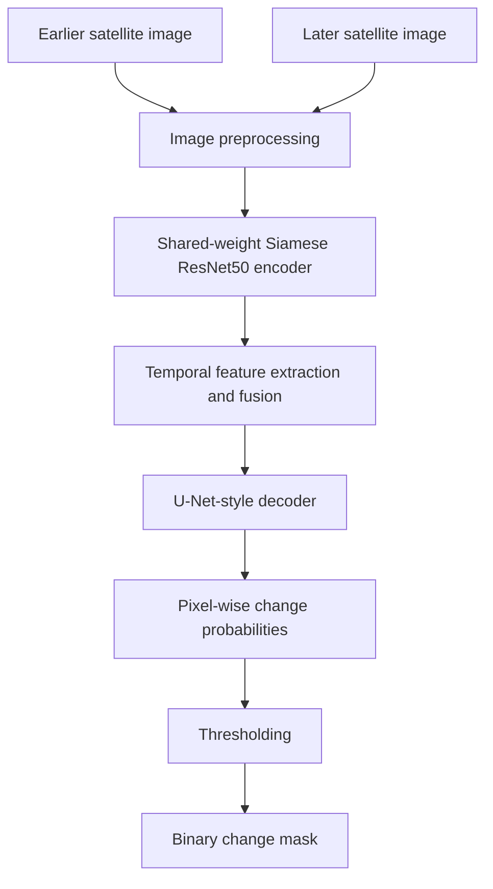

# Building Change Detection Using Deep Learning

A supervised deep-learning project for detecting building changes from bi-temporal satellite imagery. The system takes an image of a location at an earlier time and another image of the same location at a later time, then predicts a pixel-level binary change mask.

**Project:** Building Change Detection using Siamese U-Net Architectures  
**Dataset:** LEVIR-CD (project-organised subset)  
**Institution:** IIITDM Kancheepuram  
**Team:** Team 13

## Overview

Building change detection is useful for monitoring urban development, identifying newly constructed or removed buildings, and analysing changes in built-up areas. In this project, we investigate a sequence of Siamese encoder-decoder models and compare changes to their preprocessing, temporal feature fusion, attention, loss function, input resolution, and spatial feature extraction.

The main pipeline is:

The final M5 variant retains the higher-resolution M2 temporal-fusion pathway and adds a shallow temporal feature branch intended to provide additional spatial detail to the decoder.

## Dataset

The experiments use the **LEVIR-CD** building change detection dataset, obtained from [Kaggle](https://www.kaggle.com/datasets/mdrifaturrahman33/levir-cd).

The project uses a locally organised subset of 637 bi-temporal image pairs:

| Subset | Image pairs |
|---|---:|
| Training | 445 |
| Validation | 64 |
| Testing | 128 |
| **Total** | **637** |

Each sample consists of an earlier RGB image, a later RGB image of the same geographical area, and a binary ground-truth change mask. The models use two input resolutions:

- **128 × 128** for the initial and standard-resolution experiments.
- **256 × 256** for the higher-resolution M2-256 and M5 experiments.

Ground-truth masks are resized with nearest-neighbour interpolation to preserve their binary labels. The split above describes this project's subset; it should not be treated as the original benchmark's official split. The corresponding image-pair lists should be retained with the project files to support reproducibility and to check for overlap between subsets.

## Model development

The project evaluates the following configurations:

| Model | Main change investigated |
|---|---|
| **M0 – Initial Siamese U-Net** | Shared ResNet50 encoder, absolute-difference feature fusion, and U-Net-style decoder. This was the initial exploratory implementation. |
| **M1 – Corrected baseline** | Retains the Siamese architecture and improves image preprocessing, temporal-pair verification, mask resizing, and the training procedure. |
| **M2 – Enhanced temporal fusion** | Concatenates the two temporal feature maps and their absolute difference, followed by a 1 × 1 convolution, batch normalisation, and ReLU. |
| **M3 – CBAM at multiple scales** | Applies channel and spatial attention to all four projected temporal-fusion scales: 64 × 64, 32 × 32, 16 × 16, and 8 × 8. |
| **M3.1 – Selective CBAM** | Applies CBAM only at the 64 × 64 and 32 × 32 scales. The 16 × 16 and 8 × 8 projected features pass to the decoder without CBAM. |
| **M4 – Focal Tversky loss** | Investigates a Focal Tversky loss configuration with α = 0.6, β = 0.4, and γ = 1.33. |
| **M2-256** | Extends the M2 fusion approach to 256 × 256 inputs and adjusts the decoder to produce a 256 × 256 mask. |
| **M5 – Shallow feature branch** | Adds a shallow branch that processes both dates, forms their feature difference, concatenates the three representations, and projects them before integration with the main decoder. |

The M5 shallow branch uses a lightweight convolutional path with a 16-channel convolution, batch normalisation, ReLU, a depthwise-separable convolution, temporal feature concatenation, and a 1 × 1 projection.

## Experimental results

The following table records the principal results reported in the project report. Metric values are percentages. Thresholds are shown because the runs were evaluated at different operating points.

| Model | Run | Threshold | Accuracy | Precision | Recall | F1-score | IoU |
|---|---|---:|---:|---:|---:|---:|---:|
| M0 | Principal | 0.50 | 93.49 | 36.80 | 25.31 | 29.99 | 17.64 |
| M1 | Principal | 0.40 | 94.51 | 46.93 | 59.71 | 52.56 | 35.64 |
| M2 | Principal | 0.40 | 95.73 | 56.84 | 67.11 | 61.55 | 44.46 |
| M3 | Principal | 0.40 | 95.29 | 52.96 | 66.59 | 58.99 | 41.84 |
| M3.1 | Principal | 0.45 | 95.37 | 53.73 | 65.02 | 58.84 | 41.68 |
| M4 | Principal | 0.25 | 95.13 | 51.75 | 62.75 | 56.72 | 39.59 |
| M2-256 | Principal, seed 42 | 0.55 | 97.35 | 73.38 | 75.15 | 74.25 | 59.05 |
| M2-256 | Common-threshold run, seed 43 | 0.45 | 97.3388 | 73.0249 | 75.7183 | 74.3472 | 59.1688 |
| M5 | Common-threshold run, seed 44 | 0.45 | 97.3760 | 73.8721 | 75.0077 | 74.4356 | 59.2808 |

### How to interpret the results

- M2 improves on M1 in the reported experiment after introducing the three-part temporal fusion representation: features from the earlier image, features from the later image, and their absolute difference.
- M3 and M3.1 do not exceed M2 on F1-score or IoU in the reported runs. Adding attention did not automatically improve performance in these configurations.
- M4's selected Focal Tversky configuration also does not exceed M2 in the reported results.
- M2-256 records a substantially higher F1-score and IoU than the 128 × 128 M2 run. However, this is not a resolution-only ablation: the 256-pixel experiment also uses a smaller batch size, mixed-float16 computation, and an additional decoder upsampling stage.
- The common-threshold M2-256/M5 comparison uses seed 43 for M2-256 and seed 44 for M5. Both use threshold 0.45, but the different seeds mean this is not a matched-seed controlled ablation. The small difference should not be treated as proof that M5 consistently outperforms M2-256.
- The principal M2-256 result (seed 42, threshold 0.55) is a separate run from the common-threshold comparison.
- M0 is an earlier exploratory run. Its notebook also contains a threshold sweep on test predictions; the report uses its fixed-threshold 0.50 result. The later models select candidate thresholds using validation predictions before final test evaluation.

Metrics are calculated by flattening the predicted and ground-truth masks across the test samples and forming one confusion matrix. The reported scores are therefore **global pixel-level metrics**, not unweighted averages of per-image scores.

## Evaluation metrics

The models are evaluated using:

- **Accuracy:** fraction of all pixels classified correctly.
- **Precision:** fraction of predicted changed pixels that are correct.
- **Recall:** fraction of actual changed pixels detected by the model.
- **F1-score:** harmonic mean of precision and recall.
- **Intersection over Union (IoU):** overlap between the predicted and ground-truth change regions.

Precision, recall, F1-score, and IoU are particularly useful because unchanged pixels generally make up a large part of satellite images.

## Notebooks and project files

The repository contains the model-development notebooks and the final inference demonstration notebook. The notebooks cover the M0–M5 experiments, including the separate M2-256 runs, and retain the training, validation, and test evaluation workflow.

The final M5 inference notebook is intended for demonstrating prediction with a saved trained model. It accepts the earlier and later images separately and can optionally accept a ground-truth mask for comparison. Ground truth is not required to generate a prediction; it is only needed to compare the prediction with the labelled result and calculate evaluation metrics.

> **Note:** Trained checkpoints and generated outputs may be stored separately from the notebooks because of file-size limits. Check the repository's model/output folders and the paths configured near the start of each notebook before running inference. A model checkpoint must match the corresponding architecture and input resolution.

## Running the notebooks

The experiments were developed in a notebook-based workflow, with Google Colab used for GPU-backed training, including the higher-resolution experiments.

1. Clone or download this repository.
2. Open the required notebook in Google Colab or a compatible Jupyter environment.
3. Make the LEVIR-CD project subset available to the runtime and update the dataset paths in the notebook's configuration cells.
4. Select a GPU runtime when available. The 256 × 256 experiments require more memory than the 128 × 128 experiments.
5. Run the cells in order for the selected experiment. Training notebooks perform training and evaluation; the final inference notebook should load the matching saved checkpoint rather than retrain the model.
6. For the interactive M5 demonstration, provide an earlier image and a later image of the same area, in the expected RGB format and spatially aligned. Upload a ground-truth mask only when a labelled comparison is required.

Use the preprocessing and threshold associated with the selected checkpoint. In particular, the ResNet50 preprocessing used during training must also be used during inference. Do not substitute a different normalisation procedure or a threshold from another model run.

### Runtime and dependencies

The notebooks use a Python deep-learning environment with TensorFlow/Keras and image/data-processing libraries. Refer to the import and setup cells in the specific notebook for the exact packages and versions used by that experiment. The repository does not assume that every notebook can be run with one universal dependency version.

## Limitations

- The experiments use a project-organised subset of 637 image pairs; results should be interpreted in that context.
- Model results depend on training configuration, random initialisation, and threshold selection.
- The principal model results use different thresholds, so direct ranking across all rows is not a strictly controlled comparison.
- The M2-to-M2-256 comparison changes more than input resolution.
- The M2-256/M5 common-threshold comparison uses different random seeds and does not establish a consistent improvement from the shallow branch.
- The experiments focus on aligned, bi-temporal RGB imagery. Misregistration, sensor changes, and domain shift remain challenging cases.
- Higher-resolution inputs increase computational and memory requirements.

## Team

**Team 13 — IIITDM Kancheepuram**

- P. Manoj Kumar — CS24B1024
- R.V. Pruthvi Ram — CS24B1022
- Qamar Abbas — CS24B1068
- S. Valmiki Vinay — CS24B1040

## References

The literature review for this project draws on selected papers from the team's literature survey, including work on HANet, UCDNet, BWFNet, SAUNet3+CD, DCAT, BuildingCDNet, and BiFA. Full bibliographic details and the in-text citation mapping are provided in the project report. The dataset source is linked in the [Dataset](#dataset) section above.

---

*This repository documents the implementation and experiments carried out for an academic project. Reported metrics are specific to the configurations and data split described above.*
